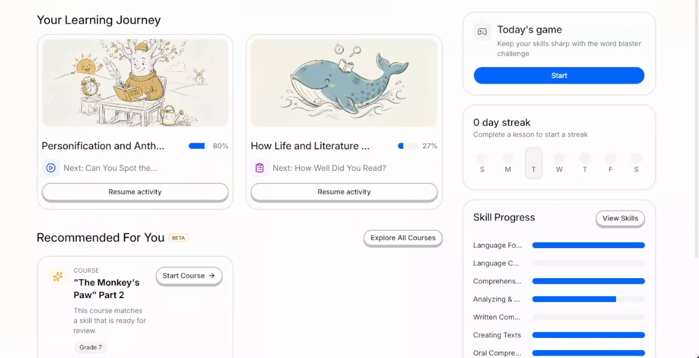

XP is earned through course activities and games. See the [XP guide](/guides/tutorials/how-xp-works) for the current rules and where to find them in the app.

<Frame caption="The Student home page shows course activities, today's game, and streak progress.">
  
</Frame>
