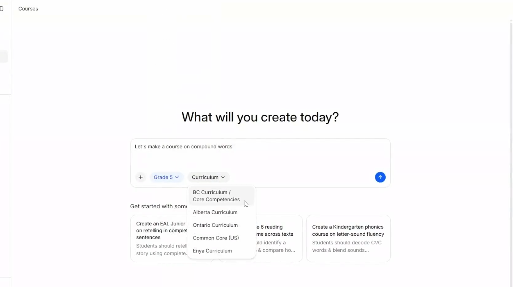
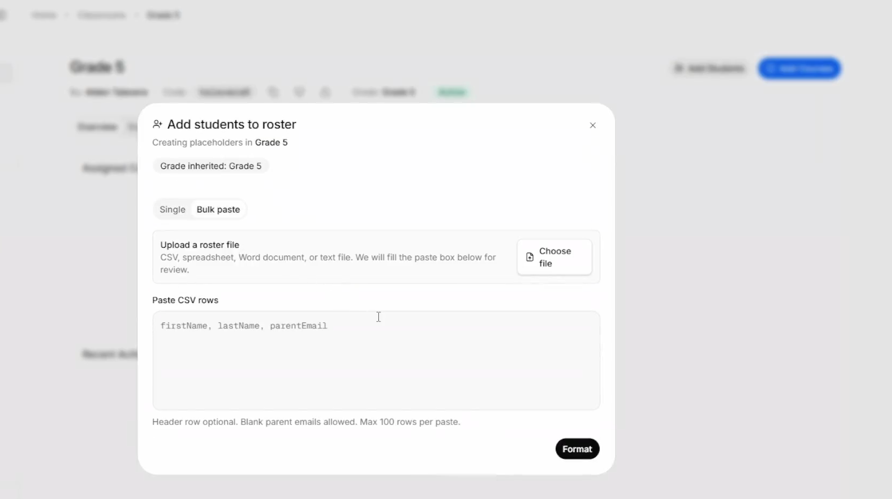
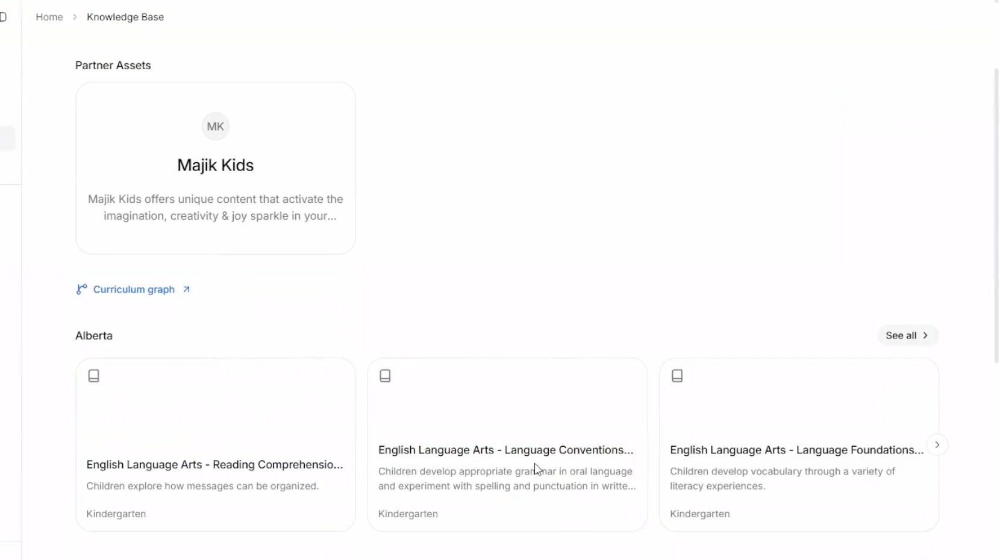

Enya Learning helps educators build courses and follow student learning.

<Frame caption="Create a course, set up a classroom, and explore the tools available to educators.">
  <video
    controls
    muted={false}
    playsInline
    preload="metadata"
    poster="/images/teacher-overview-poster.jpg"
    src="/videos/teacherdashboard.mp4"
    className="w-full aspect-video rounded-xl"
    aria-label="Teacher dashboard walkthrough"
  >
    Your browser does not support HTML video. <a href="/videos/teacherdashboard.mp4">Download the walkthrough video</a>.
  </video>
</Frame>

## Create a course

1. Start with your own course prompt or choose a pre-made example.
2. Select the grade and curriculum for the course.
3. Answer the follow-up questions. More detail helps tailor the course to your needs.
4. Add presentations, videos, quizzes, or resources from Enya or your collection.
5. Start generation. You can continue setting up your classroom while the course is prepared.

<Frame caption="Draft a course prompt and choose its grade and curriculum.">
  
</Frame>

## Set up a classroom

Create a classroom with a name, description, and grade level. Share its join code with students, or present the code to your class. From the class dashboard, review attendees, available courses, and analytics.

To add students yourself, use **Add Student**. You can also import students from a CSV file.

<Frame caption="Add students with a roster file or paste roster rows.">
  
</Frame>

## Review and assign courses

Open a course to review its units and activities. Use the course details menu to edit the title or change the course card image by generating a new one or providing your own. Select a course section to review its components, and edit or remove items as needed.

When the course is ready, open **Classrooms** and choose **Add courses** to assign it. Browse Enya courses to review their units and activities. You can copy a course or add it directly to your classroom. Use **Print** when you need a paper copy.

## Add knowledge sources

Open **Resources** to browse materials shared with you. If **Knowledge Base** appears in your sidebar, use it to browse curriculum resources by region and add sources to courses.

<Frame caption="Browse partner assets and curriculum resources in Knowledge Base when it is available.">
  
</Frame>

## Follow learning and share feedback

Open **Analytics** to review information about your students and their learning. To send feedback about Enya Learning, open **Feedback** in the lower-left area of the dashboard.

The tools available to you may depend on your role and school or program setup.

[Back to the guide home](/guides)
