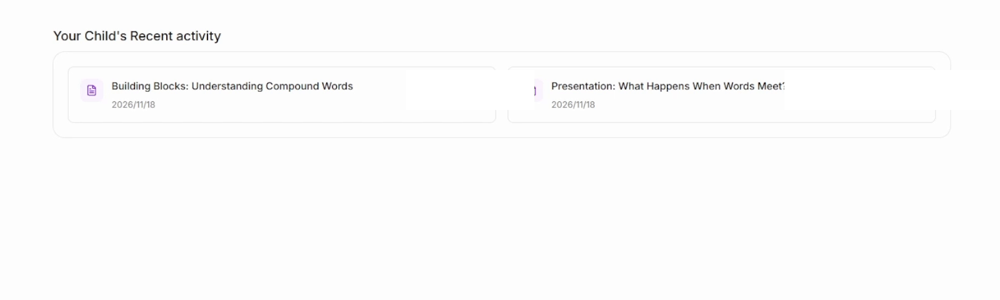
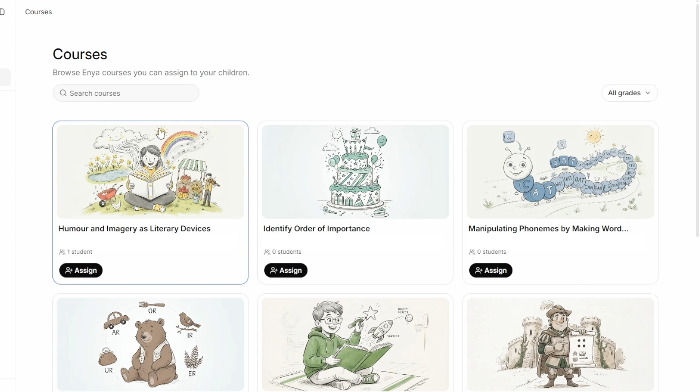

Enya Learning helps you follow learning connected to your parent account and find courses and resources shared with your family.

<Frame caption="Parent dashboard walkthrough">
  <video
    controls
    playsInline
    preload="metadata"
    src="/videos/parent-dashboard.mp4"
    className="w-full aspect-video rounded-xl"
    aria-label="Parent dashboard walkthrough"
  >
    Your browser does not support HTML video. <a href="/videos/parent-dashboard.mp4">Download the walkthrough video</a>.
  </video>
</Frame>

## Start at Home

Open **Home** to see recent activity for your connected students. Activity cards can show completed videos or quizzes, including details such as a video duration or quiz score.

<Frame caption="Recent activity cards on the Parent Home page.">
  
</Frame>

If a student has not finished joining a classroom, Home may show a **Pending** card with a classroom join code. Share that code with your child. Once they enter it in Enya Learning, their progress can appear in your parent dashboard.

## Find your students

Open **Students** to see the student accounts connected to you. Select a student to view the learning information available for that account.

## Browse courses

Open **Courses** to browse Enya courses you can assign to your children. Search the course library, filter by grade, and preview a course before assigning it.

<Frame caption="Search the course library and filter available courses by grade.">
  
</Frame>

## Find school resources

Open **Resources** to browse materials shared by your child's school. Search by title or description, filter by resource type, then preview or download available items.

## Open your guides

Choose **Guides** in the parent navigation to return to role overviews and tutorials.

The students, courses, and resources available to you depend on your family and school setup.

[Back to the guide home](/guides)
