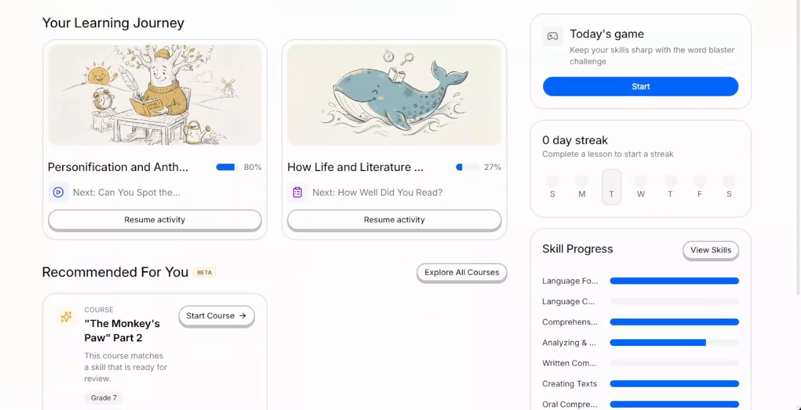
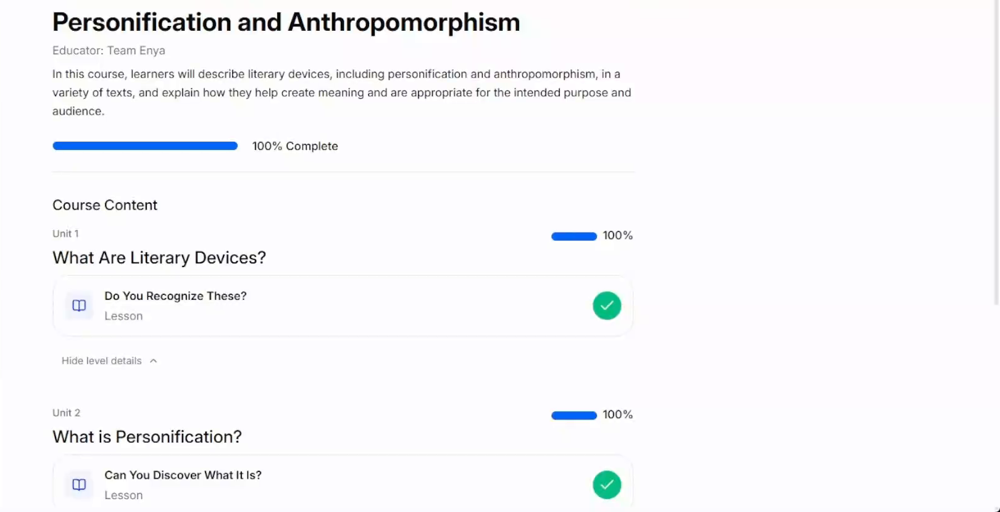
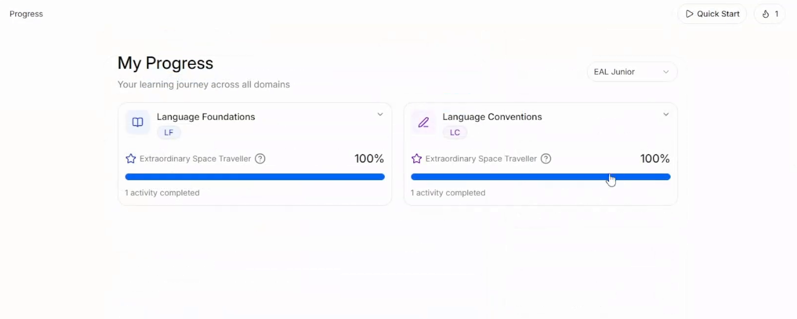

Your student dashboard brings together courses, classrooms, games, and learning progress. The options available to you can depend on your school and account settings.

<Frame caption="Student dashboard walkthrough">
  <video
    controls
    playsInline
    preload="metadata"
    poster="/images/student-home.png"
    src="/videos/student-dashboard.mp4"
    className="w-full aspect-video rounded-xl"
    aria-label="Student dashboard walkthrough"
  >
    Your browser does not support HTML video. <a href="/videos/student-dashboard.mp4">Download the walkthrough video</a>.
  </video>
</Frame>

## Start at Home

Open **Home** for your current courses, course recommendations, and quick learning stats.

<Frame caption="Student Home shows courses, activity, and learning progress.">
  
</Frame>

## Explore courses

Choose **Explore** to browse available courses. Search the course library, filter by grade, and open a course to work through its activities.

<Frame caption="An open course shows its units and activities.">
  
</Frame>

## Find or join a classroom

Open **Classrooms** to view your classes. To join a new classroom, select **Join a Classroom** and enter the code from your teacher. See the [joining a classroom tutorial](/guides/tutorials/joining-a-classroom) for the steps.

## Practice and track progress

- **Games** — open the games available to your account for extra practice.
- **Skills** — review your skill progress. Completing activities can add to this view.
- **Leaderboard** — see the leaderboard when it is enabled for your account.
- **XP** — check the XP summary on your student dashboard. Read [how XP works](/guides/tutorials/how-xp-works) for activity and game rules.

<Frame caption="My Progress summarizes learning across domains.">
  
</Frame>

## Open your guides

Choose **Guides** in the student navigation to find role overviews and tutorials.

[Back to the guide home](/guides)
